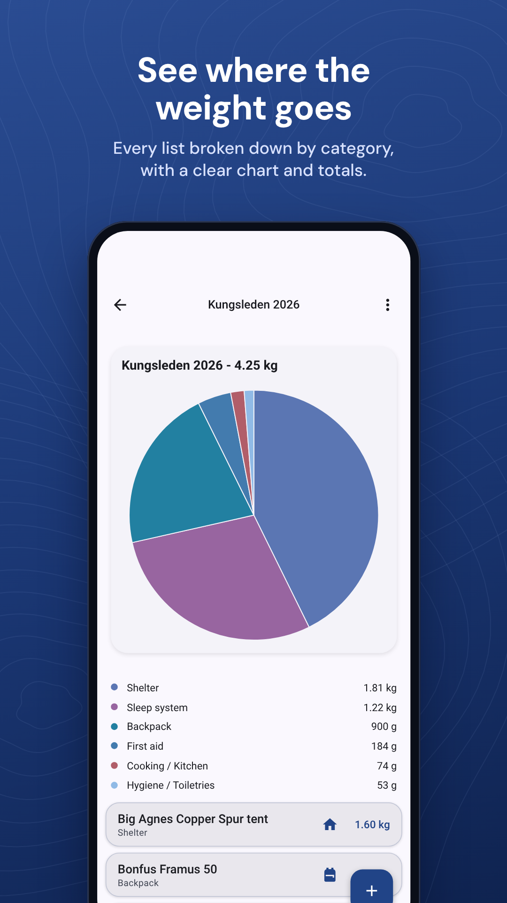
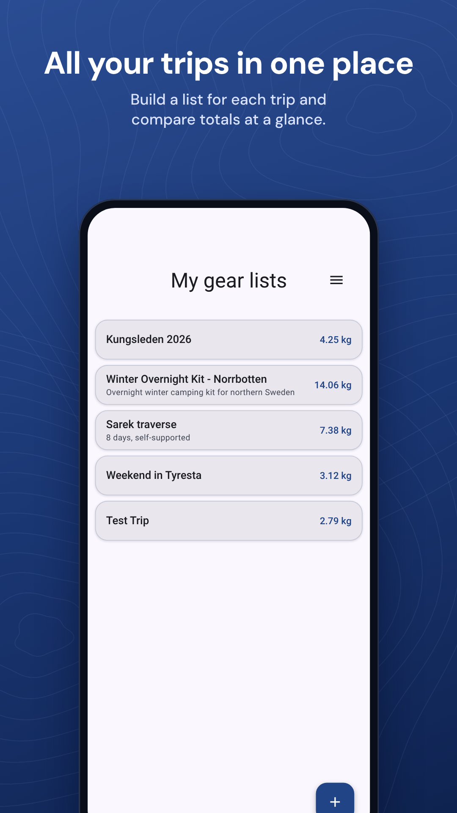
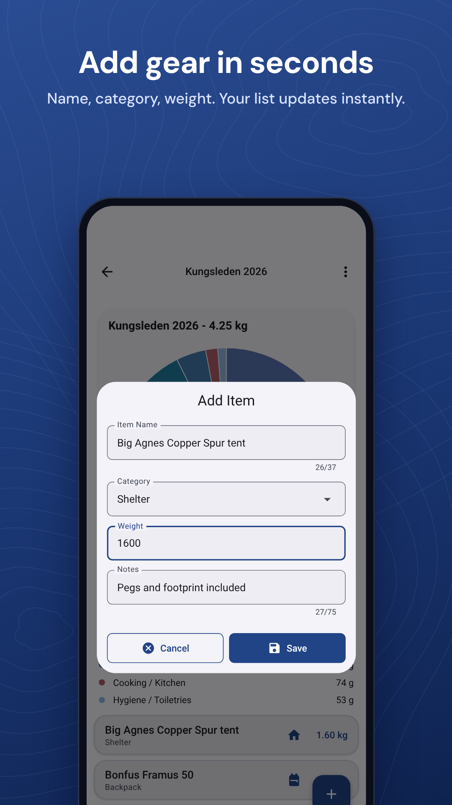
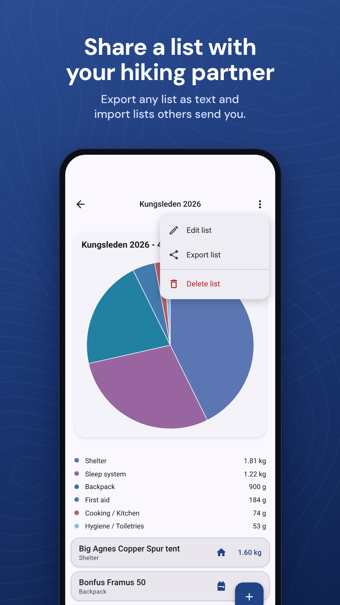
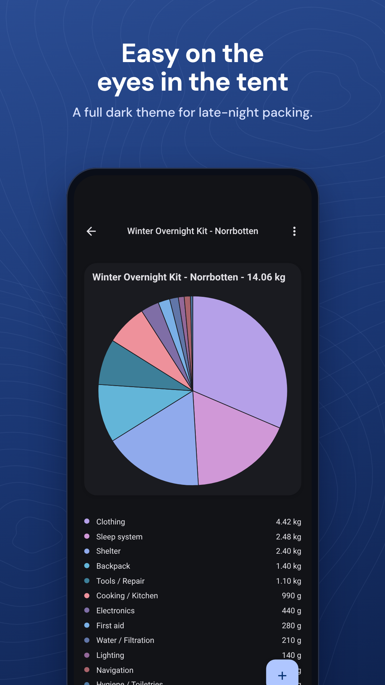
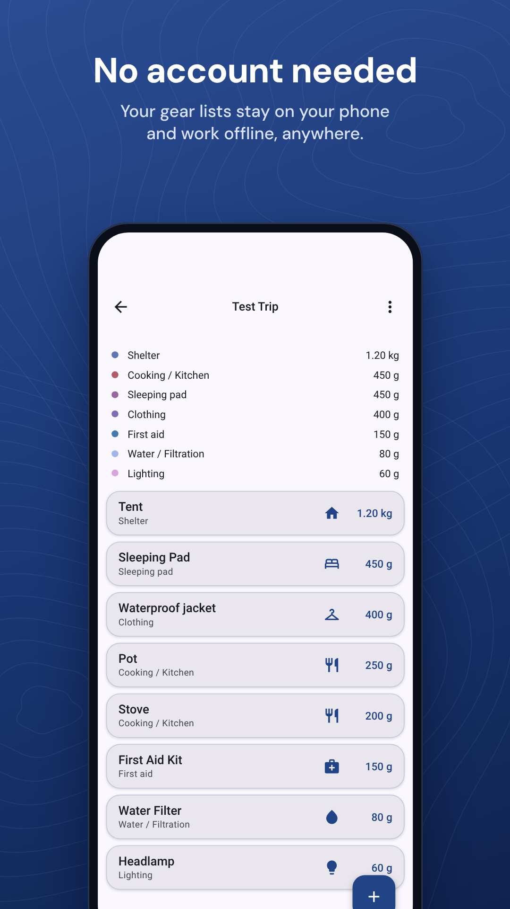

# TrailWeight


TrailWeight is a hiking gear tracker. Build a gear list for each trip, record what each item weighs, and see where the weight goes.

[Get it on Google Play]([Play Store link])

## Screenshots

<p>
  
  
  
</p>
<p>
  
  
  
</p>

## Features

- Multiple gear lists, each with its own items and weights
- Items grouped by category, with a pie chart breakdown of weight per category
- Metric or imperial units
- Light and dark themes
- Export and import of all data as a snapshot file, for backups or sharing with others
- Works offline. All data is stored on the device.

## Platforms

| Platform | Status |
|----------|--------|
| Android  | Released on Google Play |
| iOS      | In progress, not yet released |

## Tech stack

TrailWeight is built with Kotlin Multiplatform and Compose Multiplatform. The UI, data layer and business logic are shared between Android and iOS.

- **UI:** Compose Multiplatform, Navigation Compose
- **Database:** Room (multiplatform) with the bundled SQLite driver
- **Settings:** Multiplatform Settings
- **Serialization:** kotlinx.serialization, Okio

## Project structure


## Building

### Android

Requirements: Android Studio, JDK 17 or later.

```
./gradlew :androidApp:assembleDebug
```

Or open the project in Android Studio and run the `androidApp` configuration.

### iOS

Requirements: macOS, Xcode.

Open `iosApp/iosApp.xcodeproj` in Xcode and run on a device or simulator.
